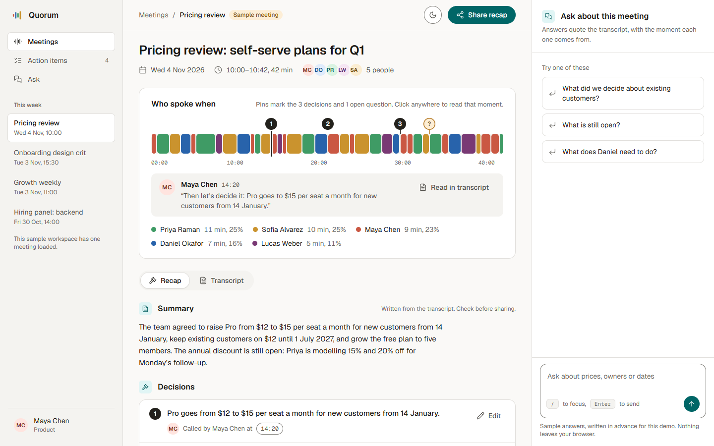
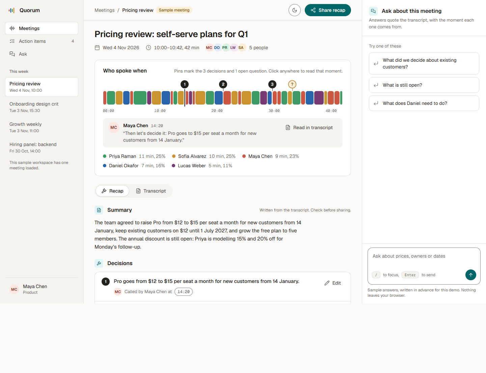
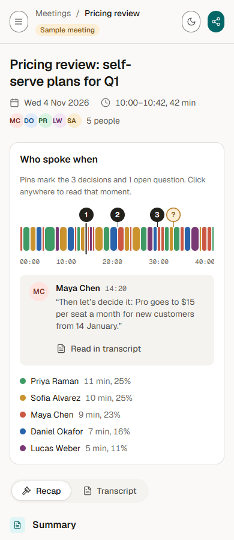

# Quorum

**Meeting recaps you can ask questions of.** Quorum turns a meeting into a recap you can read in a minute: who spoke
when, the summary, the decisions and the action items, each linked to the moment in the transcript. Then you can ask
it questions ("what did we decide on prices?", "who owns what?").



## What it is

A clickable product demo in a single HTML file: a meetings rail, one meeting's recap with a speaker ribbon on top
(filter to one speaker, jump along the timeline), summary, decisions and action items that link back into the
transcript, an ask panel, a share sheet, and a light/dark switch.

## Who it's for

People who sit in a lot of meetings, or miss some, and need the outcome and the owners without rewatching the call.

## Status

A design **prototype** of the experience, not a working product. One sample meeting is loaded. There is no recording,
transcription or AI: the answers in the ask panel are written in advance and matched by keyword, and the share link
does not open a page.

## Privacy

Everything runs in your browser and nothing leaves it. The meeting, the people and the transcript are invented sample
data. The page loads its fonts from Google Fonts, so it needs internet for them.

## Built with

Plain HTML, CSS and JavaScript in one file (`quorum.src.html`), with an inline icon sprite built from lucide-react.
Fonts: Geist and Geist Mono (Google Fonts).

## Run it

Open `preview.html` in a browser; that's the whole demo. `quorum.html` is the same page without the
`<html>`/`<head>` wrapper, for embedding.

To rebuild after editing `quorum.src.html`:

```sh
npm install
npm run icons   # rebuilds icons.svg from lucide-react (edit NAMES in icons.mjs to add icons)
npm run build   # inlines icons.svg and writes quorum.html and preview.html
```

## Screenshots

| | |
|---|---|
|  |  |

More: [full page on a phone](docs/screenshots/quorum-390-full.png)

## Licence

MIT, see [LICENSE](LICENSE). Copyright (c) 2026 Ankeet Panda.

## Third-party notices

- Icons: [Lucide](https://lucide.dev) (ISC licence); the icon paths are copied into `icons.svg`, `quorum.html` and
  `preview.html`.
- Fonts: Geist and Geist Mono, SIL Open Font License 1.1, loaded from Google Fonts at runtime (not bundled).

Full third-party licence texts are in [licenses/](licenses/).
